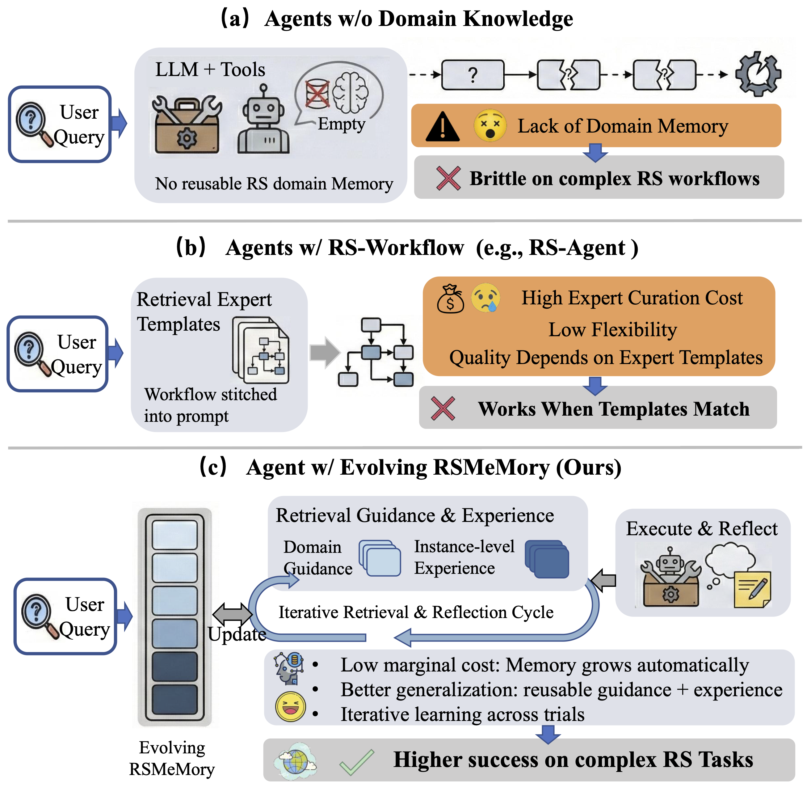
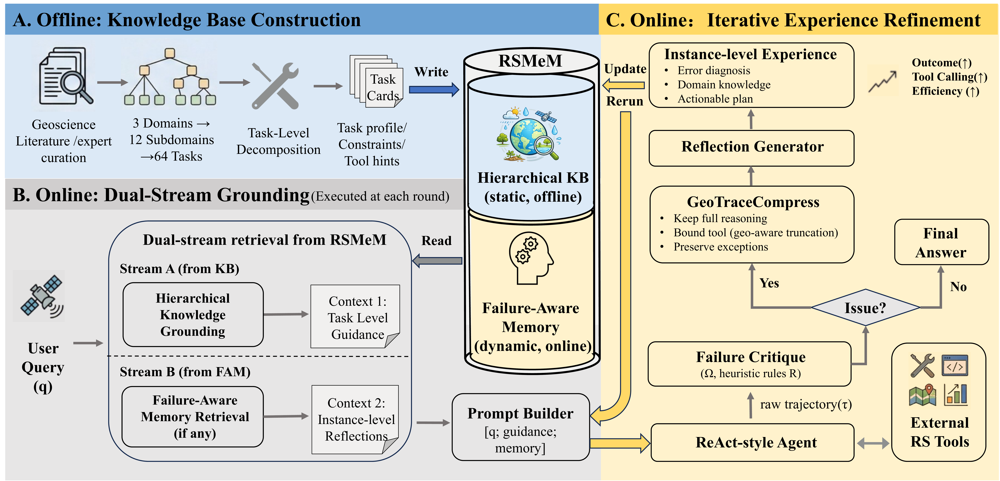

<div align="center">

# ***RSMeM: Knowledge-Enhanced Memory Evolution for Remote Sensing Agents with Systematic Evaluation***


[](https://arxiv.org/abs/2607.24772) [](https://modelscope.cn/studios/wbx929/RSMeM) [](https://2026.aclweb.org/) [](https://www.python.org/downloads/) [](LICENSE)

</div>

<div align="center">

<p><i>Comparison of RS agent architectures. (a) Agents w/o Domain Knowledge lack reusable memory, leading to brittle workflows. (b) Agents w/ RS-Workflow rely on static expert templates, which are inflexible and costly to curate. (c) Agent w/ Evolving RSMeM (Ours) integrates hierarchical grounding with failure-aware reflection, enabling iterative knowledge evolution and robust execution for complex RS tasks.</i></p>
</div>

## 🔥 News
- **[2026/08]** 🎮 Try the interactive demo on [ModelScope Studio](https://modelscope.cn/studios/wbx929/RSMeM).
- **[2026/08]** 🚀 Released the **experiment configs** (5 backbones × baseline/RSMeM + HKG/FAR ablations) and the **evaluation pipeline** (EarthBench & ThinkGeo).
- **[2026/07]** 📦 Code will be released progressively.
- **[2026/05]** 🎉 ***RSMeM*** is accepted to **ACL 2026 Main Conference**! [[arXiv](https://arxiv.org/abs/2607.24772)]

## 🌟 What is ***RSMeM***?

***RSMeM*** is a knowledge-enhanced memory evolution mechanism that bootstraps RS agents with pre-distilled domain knowledge and iteratively integrates online experience for robust multi-step tool execution. It consists of two key components:

- **Hierarchical Knowledge Grounding (HKG)**: Taxonomy-aware retrieval over a hierarchical domain corpus (3 domains → 12 subdomains → 64 atomic tasks) to guide planning and tool selection.
- **Failure-Aware Experience Refinement (FAR)**: Distills failure-annotated tool-use traces into reusable constraints for next-round tool execution.

***RSMeM*** achieves a **6% accuracy improvement** on DeepSeek-V3.2 with **< 1% additional experience tokens**, and demonstrates consistent gains across diverse LLM backbones, including DeepSeek-V3.2, Qwen3-8B/32B, Kimi-K2, on **EarthBench**. These results suggest that memory evolution can serve as a bridge from **static remote sensing domain knowledge** to **dynamic, instance-level execution experience**, enabling RS agents to become more reliable through their own failures.

<div align="center">
  
</div>


## 🧩 To-Do List
- [x] Release the **Paper**
- [x] Release the **Configuration Files** (see [`configs/`](configs))
- [x] Release the **Evaluation Pipeline** (see [`evaluation/`](evaluation))
- [ ] Complete and release the **GPU Tool Deployment** package (the MCP tool interfaces are available in [`tools/`](tools))
- [x] Release the **Core Framework** (see [`rsmem/`](rsmem))
- [x] Release the **Knowledge Base** (see [`knowledge_base/`](knowledge_base))
- [x] Release support for EarthBench
- [ ] Release support for ThinkGeo


## 🚀 Getting Started

### Installation

```bash
git clone https://github.com/AI9Stars/RSMeM
cd RSMeM

python -m venv .venv && source .venv/bin/activate
pip install -r requirements.txt
pip install -e .
pip install -r tools/requirements-tools.txt   # optional: MCP tool scripts (GDAL, fastmcp, …)
```

### Configure API keys

The files under [`configs/`](configs) are sanitized templates. Copy the template
you need to a `*_local.yaml` file (ignored by Git), then fill in `api_key` and
`base_url`. Do not commit credentials.

```yaml
base_url: ""              # your OpenAI-compatible endpoint
api_key: ""               # paste your key here (leave empty to send "EMPTY")
```


### Prepare benchmark data

RSMeM is evaluated on **EarthBench** (from [Earth-Agent](https://github.com/opendatalab/Earth-Agent)). 

```bash
# 1) Benchmark questions  ->  benchmark/question.json
mkdir -p benchmark
curl -L -o benchmark/question.json \
  https://raw.githubusercontent.com/opendatalab/Earth-Agent/main/benchmark/question.json

# 2) Evaluation ground truth
curl -L -o evaluation/extracted_tool_calls_GT.json \
  https://raw.githubusercontent.com/opendatalab/Earth-Agent/main/extracted_tool_calls_GT.json

# 3) Scene data referenced by question.json (Hugging Face dataset)
pip install -U "huggingface_hub[cli]"
hf download Sssunset/Earth-Bench --repo-type dataset --local-dir benchmark/data
```

> The scene data is large and `hf download` resumes interrupted transfers. Before running, verify that `benchmark/data/question1` through `benchmark/data/question248` exist; these paths match the references in `question.json`.

#### Data isolation for small models (optional but recommended)

**smaller models** (e.g. Qwen3-8B/32B) sometimes emit an *absolute* `benchmark/data/...` save path; because `pathlib`'s `TEMP_DIR / "/abs/path"` discards the sandbox prefix, such a write can escape into the shared dataset and contaminate it. To be safe, give each run its own data copy:

```bash
cp -rL benchmark/data benchmark/data1
# Produce question{N}.json whose benchmark/data/ paths point at benchmark/data{N}/
python benchmark/make_question_variant.py --version 1   # -> benchmark/question1.json
```

Then point each run's config at its own copy via `questions_json: benchmark/question{N}.json`.

### Embedding model 

RSMeM uses a sentence-transformer model to embed queries and knowledge-base entries. Place the model weights under `models/`:

```bash
mkdir -p models
# download from Hugging Face 
git clone https://huggingface.co/sentence-transformers/all-mpnet-base-v2 models/all-mpnet-base-v2

```

Verify the model loads correctly:

```bash
python -c "from rsmem.retrieval import EmbeddingModel; m = EmbeddingModel('models/all-mpnet-base-v2'); print(m.compute_embeddings(['test']).shape)"
# Expected: torch.Size([1, 768])
```

### Tool servers (MCP)

Full end-to-end execution lets the agent call remote-sensing perception/analysis tools over the **Model Context Protocol (MCP)**. Tool servers are declared in [`configs/agent_mcp.json`](configs/agent_mcp.json); point the YAML config's `agent_config_path` at it (already set in bundled configs):

```yaml
agent_config_path: configs/agent_mcp.json
```

Without an MCP config the agent still runs, but **tool-free** — it can plan and answer yet cannot execute perception tools. This is handy for a quick smoke test.

**Layer 1 (no GPU):** `Analysis`, `Index`, `Inversion`, `Statistics` run locally via GDAL/rasterio once installed in `.venv`.

**Layer 2 (GPU + services):** the GPU deployment package is still being
prepared and is not included in this release. The public MCP interfaces and
expected service endpoints are documented in [`tools/README.md`](tools/README.md).

### Run

RSMeM is driven by small YAML configs and a single CLI entry point:

```bash
# RSMeM on DeepSeek-V3.2
python -m rsmem run --config configs/deepseek_v32_rsmem.yaml

# Baseline on Qwen3-8B
python -m rsmem run --config configs/qwen3_8b_baseline.yaml
```

### Summary + FTRO reflection

The optional Summary+FTRO FAR strategy first asks a compressor model to turn
the previous full, numbered trajectory into grounded state claims, then asks the
reflector to produce a minimal local repair from that summary plus the legacy
full-tool-result-only (FTRO) evidence. Compressor claims must cite valid source
step IDs; API, empty-response, JSON, schema, and grounding failures stop the run
without a generic fallback.

Copy `configs/deepseek_v4flash_far_summary_ftro.yaml` to a local ignored config,
fill in the actor/reflector endpoint fields, and run:

```bash
python -m rsmem run \
  --config configs/deepseek_v4flash_far_summary_ftro_local.yaml \
  --resume-from <COMPLETED_ATTEMPT_1_RUN>
```

The compressor endpoint inherits the reflector endpoint when its URL/key fields
are empty. Feedback generated from attempt N for use in attempt N+1 is stored in
`<RUN>/feedback/attempt_N/`, including per-question summary/reflection requests,
parsed JSONL outputs, teacher payloads, hashes, and token usage. The strategy
uses a high-fidelity full trajectory for the summary (structured tool inputs;
6,000 characters per step and 120,000 per trace) while preserving the original
300-character FTRO representation used by released FAR configs.

### Project Structure

```
RSMeM/
├── rsmem/                 # Core framework
│   ├── agent.py           # LangChain MCP agent bootstrap + single-question runner
│   ├── retrieval.py       # Embedding + hybrid retrieval (HKG)
│   ├── kb.py              # Knowledge-base parsing
│   ├── memory.py          # Failure-Aware Memory (FAM)
│   ├── strategies/        # Truncation / trajectory / FAR reflection + orchestrator 
│   ├── runner.py          # Multi-attempt evaluation orchestration
│   ├── evaluation.py      # Metrics (R@3, accuracy, token efficiency)
│   └── config.py          # ExperimentConfig (YAML-driven)
├── configs/               # Configs: 5 backbones × {baseline, RSMeM, HKG, FAR}
├── tools/                 # Public MCP tool interfaces
│   └── {Analysis,Index,Inversion,Perception,Statistics}.py
├── models/                # Downloaded checkpoints (see models/README.md)
├── knowledge_base/        # Expert-curated hierarchical knowledge base
└── evaluation/            # Eval pipeline (progressive disclosure)
    ├── run_pipeline.py            # One-click orchestration (EarthBench)
    ├── run_pipeline_thinkgeo.py   # One-click orchestration (ThinkGeo)
    └── steps/                     # Step scripts invoked by the pipelines
        ├── prepare_*.py           # complete → polish → extract → merge
        └── metric_*.py            # step-by-step (R@3), end-to-end, token efficiency, NEI
```

## 🔬 Evaluation

Given a model run directory (containing `results_attempt_{N}.jsonl`, the chat log `{model}_AP_langchain.log`, and `experiment_summary.json`), the pipeline turns raw traces into metrics.

The answer-polishing step calls an OpenAI-compatible endpoint. Copy or edit a sanitized template under [`evaluation/configs/`](evaluation/configs), or set `RSMeM_API_KEY` and `RSMeM_BASE_URL`.

### One-click pipeline (with checkpoint resume)

```bash
python evaluation/run_pipeline.py \
    --config evaluation/configs/polish.yaml \
    --base-dir <RESULTS_DIR> \
    --model-name deepseek-v3.2 \
    --rounds 1,2,3 \
    --result-dir-name deepseek_rsmem_results
```

This runs, in order: `complete` → `polish` → `extract` → `merge` → step-by-step → end-to-end, writing outputs under `evaluation/results/<result-dir-name>/`.


### Resume interrupted runs

Two resume modes are supported to avoid losing progress when a run is interrupted (e.g. API quota exhaustion, network failure):

**`--continue-attempt`** — resume within the **same attempt**, re-running only the questions that failed due to API errors (HTTP 401 / empty `token_usage`). Results are written back to the **same** experiment directory, and already-completed questions are skipped automatically. Each newly completed question is flushed to disk immediately, so a second interruption won't lose prior progress.

```bash
# API quota ran out at question 55 during attempt 1 — continue from where it stopped:
python -m rsmem run \
    --config configs/deepseek_v4flash_baseline.yaml \
    --continue-attempt <PARTIAL_RUN_DIR>
```

**`--resume-from`** — resume from **attempt 2** using a completed attempt-1 directory. This creates a **new** experiment directory and copies the attempt-1 artefacts into it, then re-runs only the heuristically failed questions with FAR reflections (if enabled).

```bash
# Attempt 1 finished; start attempt 2+ from its results:
python -m rsmem run \
    --config configs/deepseek_v32_rsmem.yaml \
    --resume-from <COMPLETED_RUN_DIR>
```

> **Tip:** `--continue-attempt` is idempotent — you can run it repeatedly with updated API keys until all questions succeed.

## 📖 Citation
If you find ***RSMeM*** useful, please cite our paper:

```bibtex
@inproceedings{wu2026rsmem,
  title={RSMeM: Knowledge-Enhanced Memory Evolution for Remote Sensing Agents with Systematic Evaluation},
  author={Wu, Bingxian and Zhang, Yu and Guo, Zonghao and Liu, Tang and Qian, Chen and Lu, Yuxiang and Du, Xingbo and Li, Yanghao and Zhang, Yidan and Chen, Chi and Yao, Ling and Sun, Maosong},
  booktitle={Proceedings of the 64th Annual Meeting of the Association for Computational Linguistics (ACL)},
  year={2026}
}
```

## 📬 Contact
For any questions or collaborations, feel free to contact us :)

<p align="left">
    📧 <a href="mailto:wubingxian24@mails.ucas.edu.cn">wubingxian24@mails.ucas.edu.cn</a> &nbsp;&nbsp; | &nbsp;&nbsp; 📧 <a href="mailto:guozonghao96@outlook.com">guozonghao96@outlook.com</a>
</p>

## 🙏 Acknowledgements
We sincerely thank the following open-source projects that inspired and supported this work:
- [Earth-Agent](https://github.com/opendatalab/Earth-Agent): The upstream Earth-observation agent and **EarthBench** benchmark on which the initial RSMeM agent runner and evaluation workflow were based. RSMeM substantially refactors and extends that code with HKG and FAR (MIT License; see [`NOTICE`](NOTICE)).
- [ThinkGeo](https://github.com/mbzuai-oryx/ThinkGeo): A benchmark for evaluating tool-augmented agents on remote sensing tasks, which provides the **ThinkGeo** benchmark used in our evaluation.
- [LangChain](https://github.com/langchain-ai/langchain): A framework for developing applications powered by large language models.


## 📄 License
RSMeM-owned code is licensed under the MIT License — see [LICENSE](LICENSE).
Third-party code, models, and datasets remain subject to their original terms;
see [NOTICE](NOTICE).
